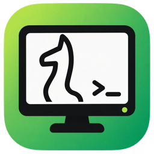
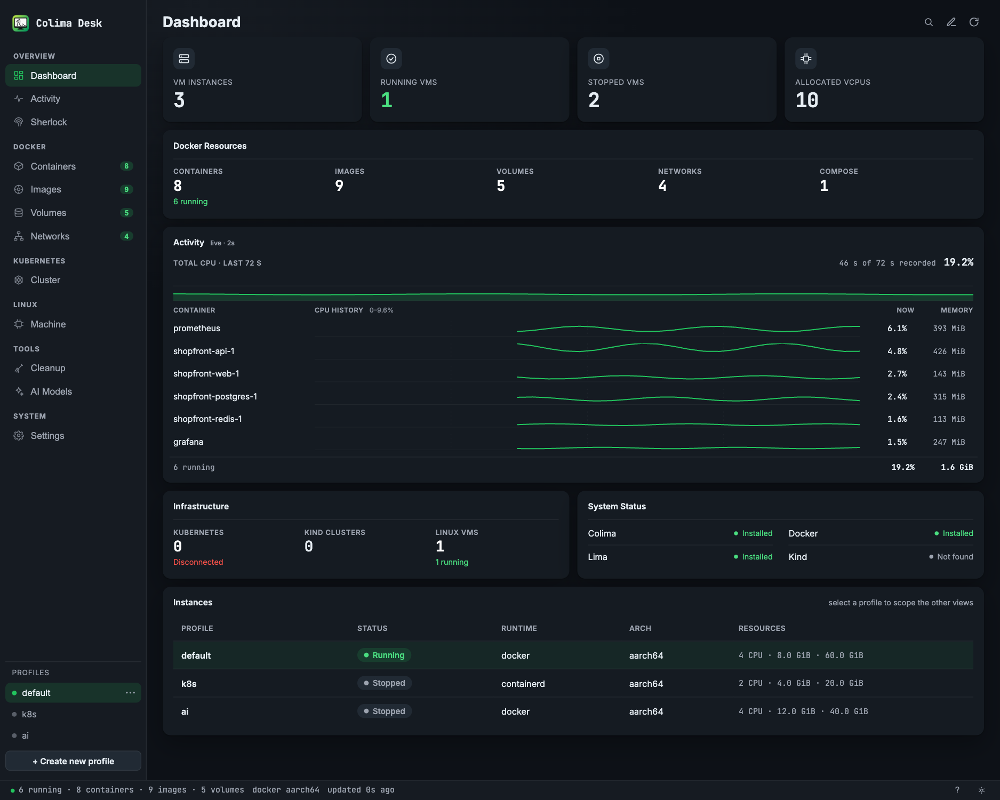
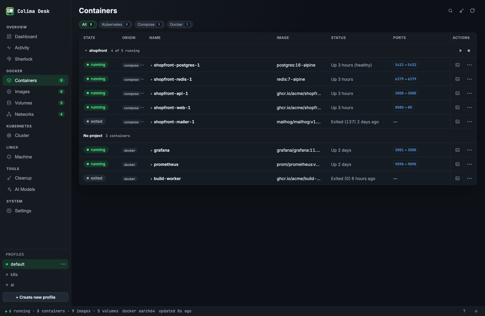
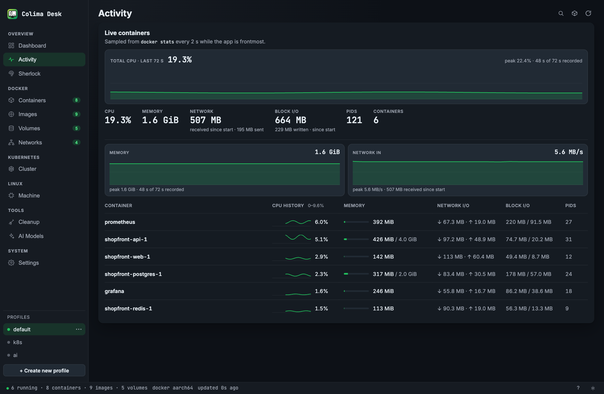
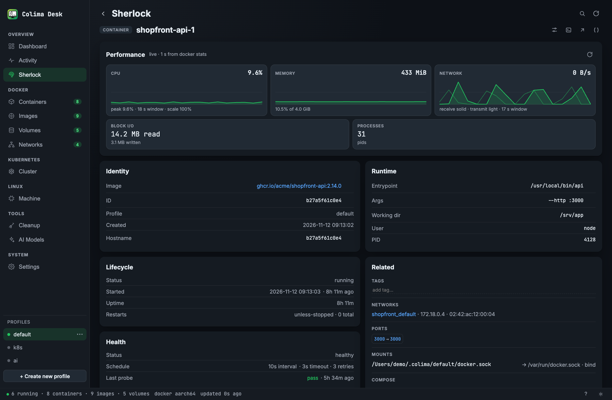
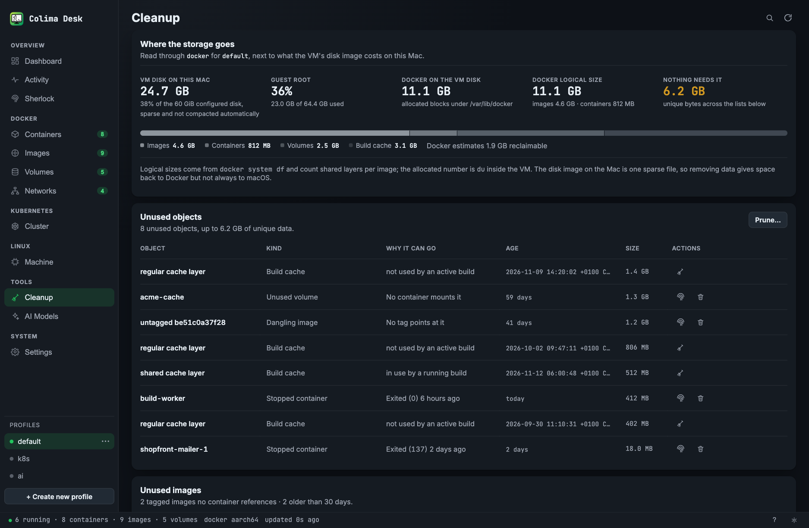
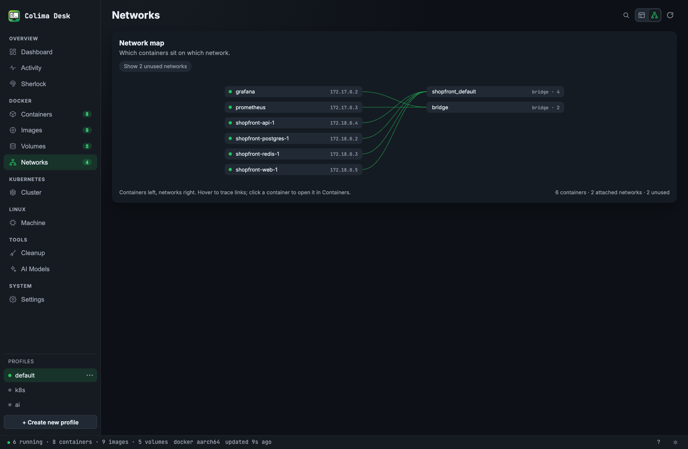
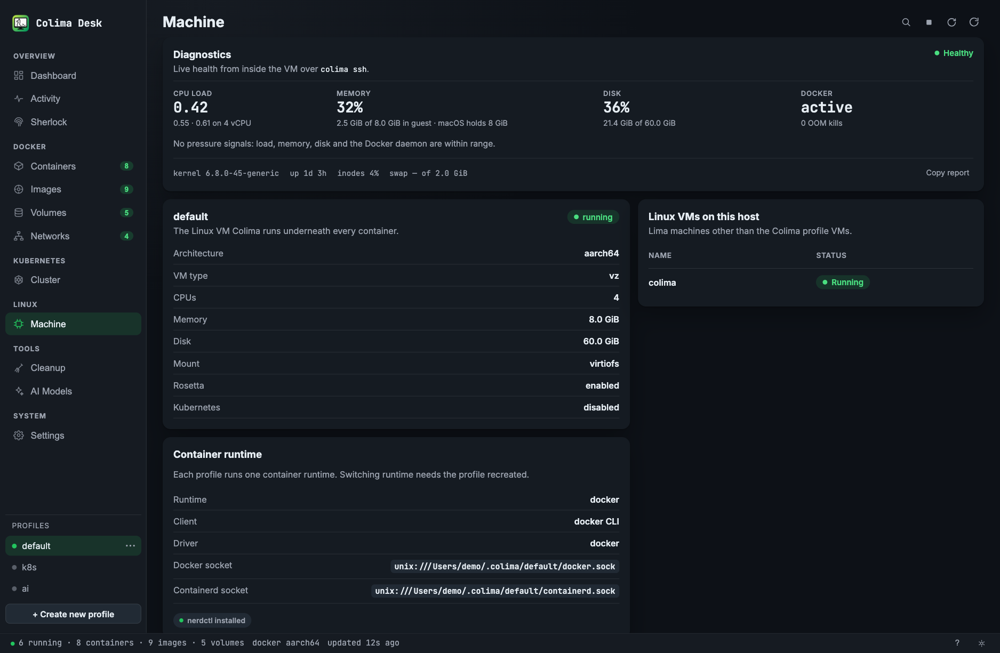

# Colima Desk




**One window over your Colima VM and the containers inside it.** No extra daemon, no database, no second source of truth — Colima Desk runs the same `colima`, `docker`, and `nerdctl` commands you already use and shows the output, with the affected object named when something fails.

Built for macOS developers who use [Colima](https://github.com/abiosoft/colima) instead of Docker Desktop.

## Why it's different

- **Runtime-aware.** Docker-runtime profiles use the Docker CLI; containerd profiles use Colima's own `nerdctl` wrapper. You pick a profile and the views follow it.
- **Live, not polled.** The dashboard updates from `docker events` — a container starting or an image being removed shows up in about a quarter second. A 60-second reconciliation pass covers the gaps.
- **Honest errors.** Nothing is reinterpreted. If Docker returns an error, you get the error text with the container or image name filled in.

## Highlights

- **Dashboard with custom cards** — profile counts, Docker resources, infrastructure, tool status, and an instances table. Drag cards to reorder them, set each width to Auto, Half, or Full, hide the ones you do not use, and reset the layout when you want the default back.
- **Activity monitor** — 72 seconds of per-container CPU, memory, and network history from two-second `docker stats` samples, with OOM warnings at 90% of a container's (or the VM's) memory limit.
- **Sherlock** — open one object and see what it's connected to: live stats, last 60 log lines, env vars with secrets masked, labels, health checks, build history, volume contents.
- **Volume browser** — browse a volume's files one directory at a time, read-only, through `colima ssh`, following Docker's tree and containerd's alike.
- **Cleanup** — `docker system df -v` plus a scan of `/var/lib/docker` and the largest container logs, with age, size, and the reason each item qualifies. Images older than 30 days are marked stale.
- **Machine telemetry** — kernel, vCPUs, load, memory, disk, inodes, swap, Docker daemon state, and recent OOM kills from one `colima ssh` round trip.
- **Kubernetes &amp; AI models** — start/stop/reset k3s, and pull, run, chat with, and serve models through Docker or ramalama.

## Screenshots



<sub>A demo profile: one running Docker profile, a four-service Compose stack, and a dangling image. macOS in dark appearance.</sub>

| Containers | Activity |
| --- | --- |
|  |  |

| Sherlock | Cleanup |
| --- | --- |
|  |  |

| Network map | Machine |
| --- | --- |
|  |  |

## Requirements

- Colima
- Docker CLI for Docker-runtime profiles (containerd profiles use Colima's `nerdctl`)
- Optional: `kubectl`, `limactl`, `kind`, `nerdctl`, `docker compose`, `ramalama`, `krunkit` — missing tools hide their sections

To build from source: Rust, Node.js 20.19+ or 22.12+, and the Xcode command line tools.

## Run it

```sh
git clone https://github.com/dm0xa/colima-desk.git
cd colima-desk
npm install
npm run tauri dev
```

Release build:

```sh
npm run bundle
```

This builds the app and the disk image, and lays the image out as the install window: a background picture, the app on the left, `Applications` on the right. The bundle lands in `src-tauri/target/release/bundle/`. It is not signed, so macOS may ask for confirmation the first time you open it.

## First launch

It checks what is installed — nothing gets installed for you. Pick a profile at the bottom of the sidebar; if it is stopped, start it from the `⋯` menu and the views fill in.

## Keyboard shortcuts


| Shortcut | Action                                          |
| -------- | ----------------------------------------------- |
| ⌘1 … ⌘9  | Jump to the first nine visible sections         |
| ⌘0       | Jump to the last visible section (Settings)     |
| ⌘K       | Search everything                               |
| ⌘R       | Refresh data                                    |
| Esc      | Close the current dialog or dashboard edit mode |
| `?`      | Show the shortcut list                          |


## Development

```sh
npm run build
npx tsc --noEmit

cd src-tauri
cargo test
cargo build
```

More detail in [docs/DEVELOPMENT.md](docs/DEVELOPMENT.md), [docs/ARCHITECTURE.md](docs/ARCHITECTURE.md), [docs/DASHBOARD.md](docs/DASHBOARD.md), [docs/USAGE.md](docs/USAGE.md), [docs/ROADMAP.md](docs/ROADMAP.md), and [CHANGELOG.md](CHANGELOG.md).

## License

MIT. See [LICENSE](LICENSE).

## Thanks

- [Colima](https://github.com/abiosoft/colima) by abiosoft
- [Tauri](https://tauri.app)
- The Colima palette and logo come from [colima.run](https://colima.run)